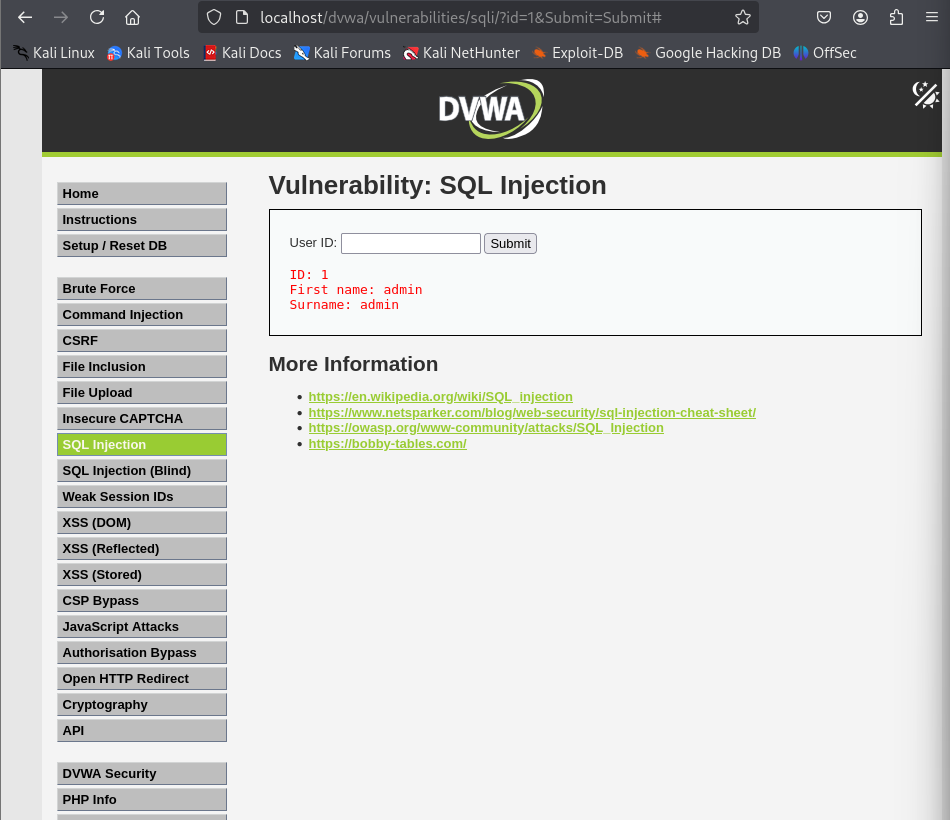
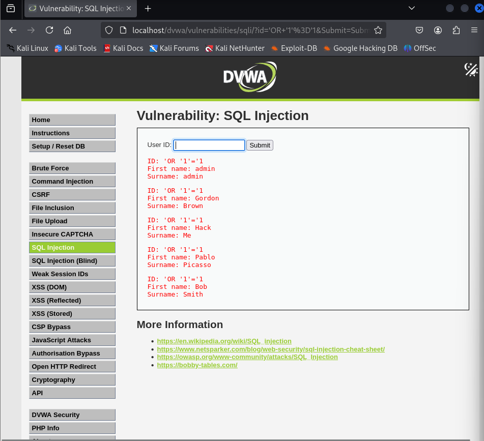
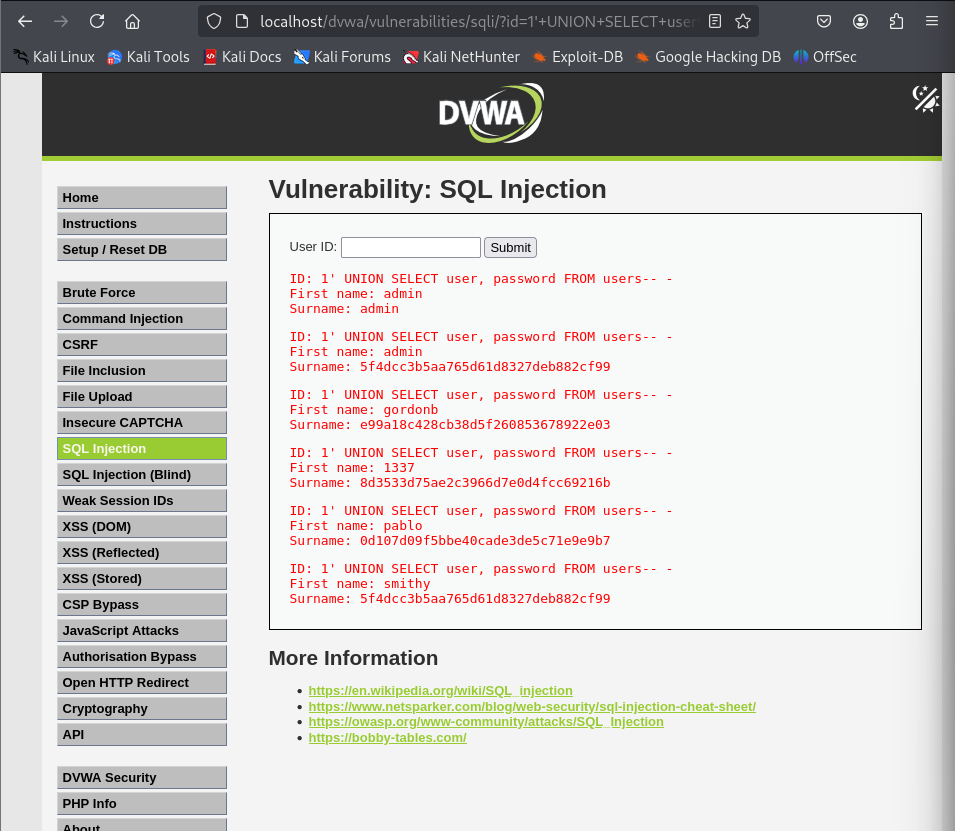
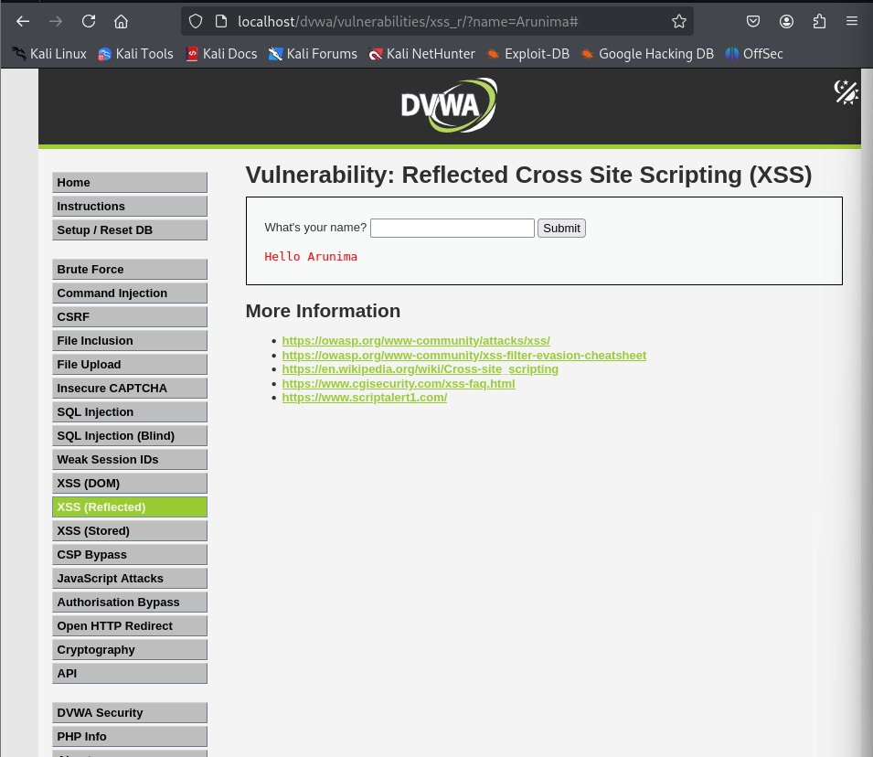
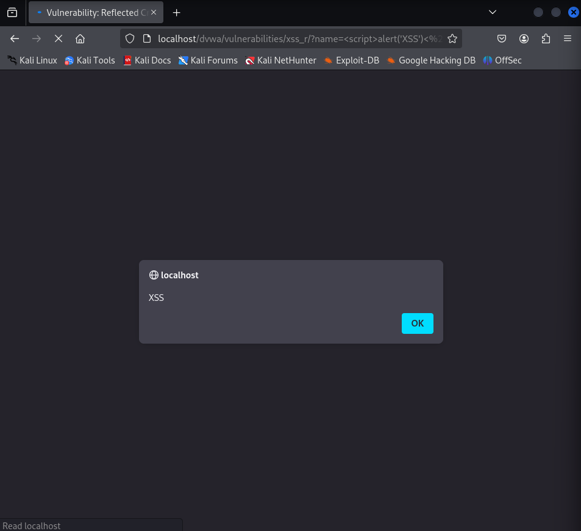
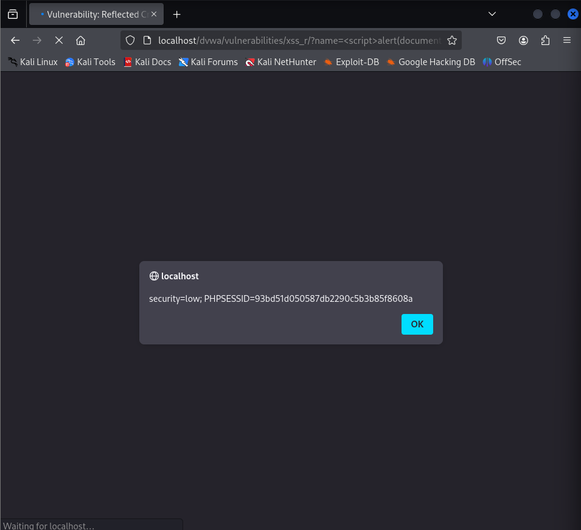
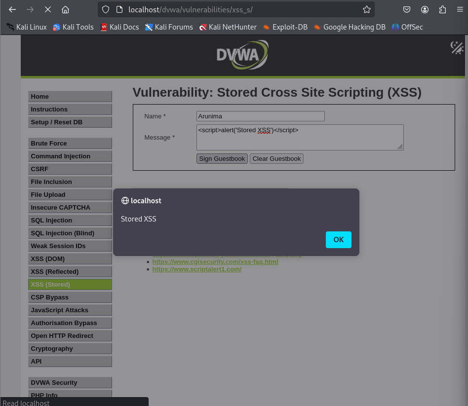
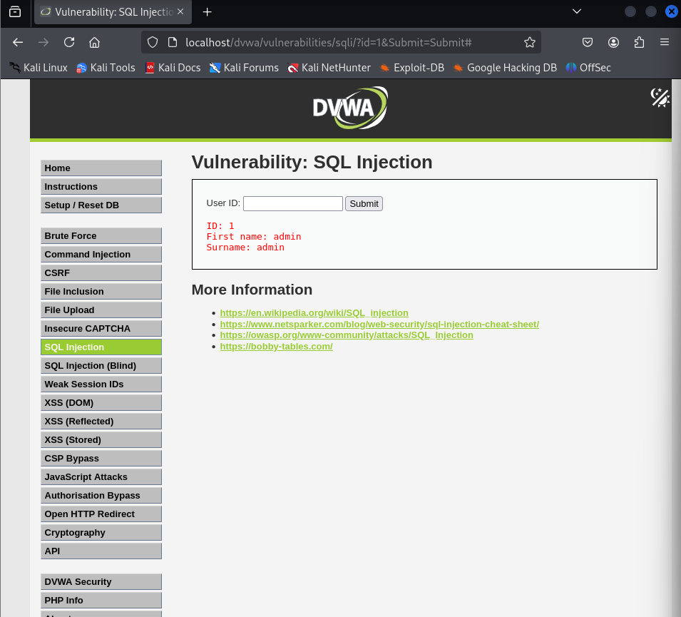
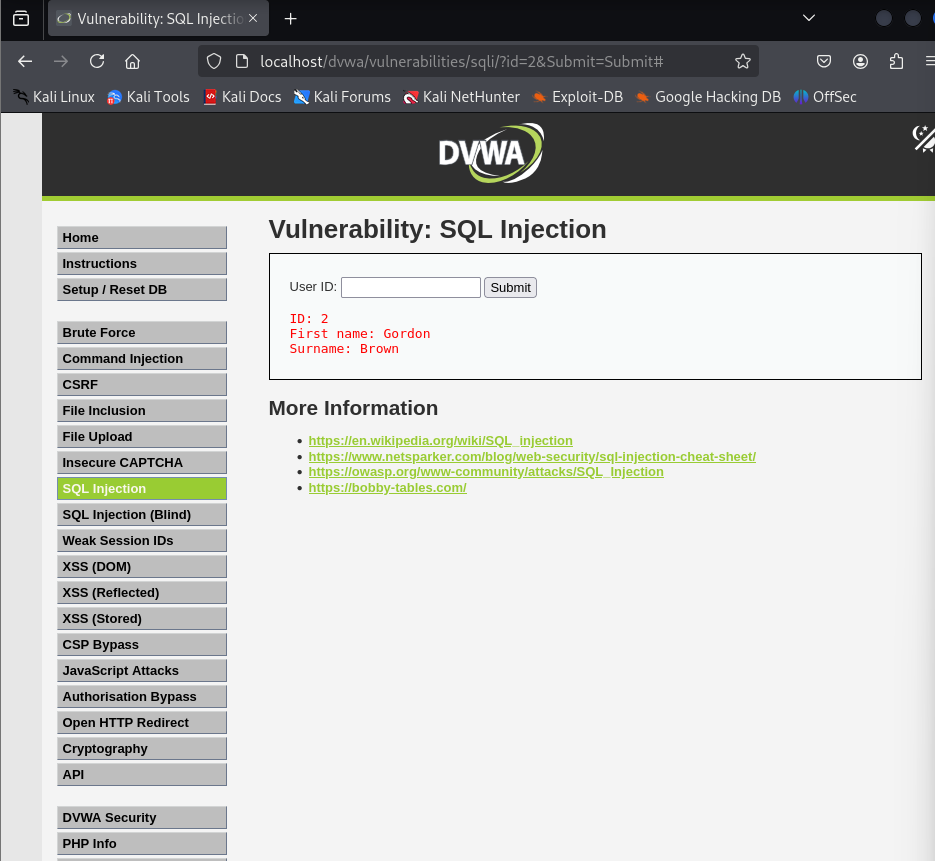

# Web Application Penetration Test — DVWA

## Overview

This report documents a web application penetration test conducted 
on DVWA (Damn Vulnerable Web Application), a deliberately insecure 
web application designed for security training purposes. The 
assessment covers the identification, exploitation, and remediation 
of four OWASP Top 10 vulnerabilities in a controlled, isolated 
lab environment.

**Assessment type:** Black-box web application penetration test  
**Methodology:** Manual testing with browser-based exploitation  
**Scope:** DVWA running locally on Kali Linux (localhost)

---

## Table of Contents

1. [Environment](#environment)
2. [Findings Summary](#findings-summary)
3. [Finding 1 — SQL Injection](#finding-1--sql-injection)
4. [Finding 2 — XSS Reflected](#finding-2--cross-site-scripting--reflected)
5. [Finding 3 — XSS Stored](#finding-3--cross-site-scripting--stored)
6. [Finding 4 — IDOR](#finding-4--insecure-direct-object-reference-idor)
7. [Key Takeaways](#key-takeaways)

---

## Environment

| Item | Details |
|---|---|
| Platform | DVWA v2.5 running on Kali Linux |
| Web Server | Apache2 |
| Database | MariaDB |
| Security Level | Low (intentional — focus on technique over bypass) |
| Tools Used | Firefox Browser, DVWA interface, manual testing |
| Network | Localhost — completely isolated from external networks |

---

## Findings Summary

| # | Vulnerability | Severity | OWASP 2021 | Status |
|---|---|---|---|---|
| 1 | SQL Injection | 🔴 High | A03 — Injection | Documented |
| 2 | XSS Reflected | 🟠 Medium | A03 — Injection | Documented |
| 3 | XSS Stored | 🔴 High | A03 — Injection | Documented |
| 4 | IDOR | 🟠 Medium | A01 — Broken Access Control | Documented |

---

## Finding 1 — SQL Injection

**Severity:** High  
**Location:** `/dvwa/vulnerabilities/sqli/`  
**OWASP 2021:** A03 — Injection

### Description

SQL Injection occurs when user-supplied input is inserted 
directly into a database query without sanitisation or 
parameterisation. This allows an attacker to manipulate 
the query's logic, potentially extracting, modifying, or 
deleting data from the database.

**How it works conceptually:** The application builds a 
database question using the user's input directly. 
Normally it asks: *"Give me details for user number 1."* 
SQL Injection lets an attacker complete that sentence 
differently: *"Give me details for user 1, OR just 
return everything in the table."* Because the input is 
treated as part of the query structure rather than as 
data, the injected SQL executes as legitimate commands.

### Exploitation

**Step 1 — Confirm vulnerability using OR payload:**

Input supplied:

1' OR ‘1’='1


The application returned all user records instead of 
just user ID 1, confirming that the input was being 
concatenated directly into the SQL query.

**Step 2 — Extract password hashes using UNION SELECT:**

Input supplied:

1' UNION SELECT user, password FROM users-- -


The application returned all usernames and their 
corresponding password hashes from the users table.

### Evidence







### Impact

An attacker with network access to this application 
could extract all usernames and password hashes from 
the database without valid credentials. Cracking or 
reusing these hashes could lead to full account 
compromise across the application.

### Remediation

**Root cause:** User input is concatenated directly into 
the SQL query string, allowing it to be interpreted as 
SQL code rather than as data.

**Fix — Parameterised Queries (Prepared Statements):**

The correct approach is to separate the query structure 
from the data entirely. The database receives the query 
template first (with a `?` placeholder where data will 
go), and then receives the actual data value separately. 
This way, whatever the user types is always treated as 
a plain data value — never as executable SQL code — 
regardless of what it contains.

```php
// VULNERABLE — input concatenated directly into query:
// If $id = "1' OR '1'='1", the resulting query becomes:
// SELECT * FROM users WHERE id = '1' OR '1'='1'
// which returns all users
$query = "SELECT * FROM users WHERE id = '$id'";

// SECURE — query structure and data sent separately:
// Step 1: Send the query template — database receives the structure
$stmt = $db->prepare("SELECT * FROM users WHERE id = ?");

// Step 2: Bind the data value separately
// "s" tells the database to expect a string type
// Whatever $id contains is treated as a data value only
$stmt->bind_param("s", $id);

// Even if $id = "1' OR '1'='1", the database treats the
// entire string as a literal ID value to search for,
// not as SQL commands to execute
$stmt->execute();
```

**Analogy:** A bank form has a printed field labelled 
"Account number: ____". Whatever you write in that field 
is always treated as an account number — you cannot write 
"close all accounts" and have it executed as an instruction. 
Parameterised queries enforce the same separation: the 
input slot only ever accepts data, never commands.

---

## Finding 2 — Cross-Site Scripting: Reflected

**Severity:** Medium  
**Location:** `/dvwa/vulnerabilities/xss_r/`  
**OWASP 2021:** A03 — Injection

### Description

Reflected XSS occurs when user input is immediately 
returned by the server in the HTTP response without 
sanitisation, causing the browser to execute injected 
JavaScript. The key characteristic of reflected XSS is 
that the malicious input travels in the HTTP request 
and is reflected directly back in the response — 
it is not stored anywhere on the server.

### Exploitation

**Step 1 — Confirm JavaScript execution:**

Input supplied:
```html
<script>alert('XSS')</script>
```

The browser executed the script and displayed an alert 
box — confirming that user input was being reflected 
directly into the HTML response without encoding.

**Step 2 — Demonstrate session cookie access:**

Input supplied:
```html
<script>alert(document.cookie)</script>
```

The application's session cookie was displayed in the 
alert box. In a real attack, this payload would silently 
send the cookie to an attacker-controlled server rather 
than displaying it — enabling session hijacking without 
requiring the victim's credentials.

### Evidence







### Impact

An attacker could craft a URL containing the malicious 
payload and distribute it to victims via phishing or 
social engineering. When a victim clicks the link, their 
session cookie is captured by the attacker, who can then 
use it to impersonate the victim and access their account 
without needing their password.

### Remediation

**Root cause:** User input is placed directly into the 
HTML response as raw text. Browsers parse HTML and 
execute anything inside `<script>` tags, so injected 
script tags run automatically.

**Fix — Output Encoding:**

Before placing any user input into an HTML page, convert 
characters that have special meaning in HTML into their 
safe display equivalents. The browser then renders them 
as visible text instead of interpreting them as code.

Key character conversions:
| Character | Becomes | Why |
|---|---|---|
| `<` | `&lt;` | Prevents opening HTML tags |
| `>` | `&gt;` | Prevents closing HTML tags |
| `"` | `&quot;` | Prevents breaking attribute values |
| `'` | `&#039;` | Prevents breaking single-quoted attributes |
| `&` | `&amp;` | Prevents encoding sequences |

After encoding, `<script>alert('XSS')</script>` becomes 
`&lt;script&gt;alert(&#039;XSS&#039;)&lt;/script&gt;` — 
which the browser displays as harmless visible text rather 
than executing as code.

```php
// VULNERABLE — user input placed directly into HTML output:
// If name = "<script>alert('XSS')</script>", the page contains:
// Hello <script>alert('XSS')</script>
// Browser sees a script tag and executes it
echo "Hello " . $_GET['name'];

// SECURE — special characters converted before output:
// htmlspecialchars() converts < > " ' & to safe display versions
// ENT_QUOTES ensures both single and double quotes are converted
// If name = "<script>alert('XSS')</script>", the page contains:
// Hello &lt;script&gt;alert(&#039;XSS&#039;)&lt;/script&gt;
// Browser displays it as readable text — never executes it
echo "Hello " . htmlspecialchars($_GET['name'], ENT_QUOTES);
```

**Analogy:** A community noticeboard where anyone can 
post messages. If someone posts a note saying 
"FIRE — EVACUATE NOW", people read it as an instruction 
and act on it. Output encoding is like putting a display 
frame around every posted message — visitors see the 
content as an exhibit, not a directive to act on. 
The text is visible but it has lost its power to instruct.

---

## Finding 3 — Cross-Site Scripting: Stored

**Severity:** High  
**Location:** `/dvwa/vulnerabilities/xss_s/`  
**OWASP 2021:** A03 — Injection

### Description

Stored XSS is the more severe variant of Cross-Site 
Scripting. Unlike Reflected XSS, where the payload is 
reflected immediately back to a single user in one 
response, Stored XSS occurs when the malicious payload 
is saved permanently to the database. Every subsequent 
visitor to the affected page automatically executes the 
script — no link click or user interaction required.

### Exploitation

Payload submitted in the guestbook message field:
```html
<script>alert('Stored XSS')</script>
```

The script was saved to the database. On every subsequent 
page load — for every user — the alert box fired 
automatically without any further action from the attacker.

### Evidence



### Impact

A single injection affects every visitor to the page 
indefinitely until the database record is manually 
removed. In a real attack, the payload would silently 
transmit every visitor's session cookie to an 
attacker-controlled server — potentially compromising 
hundreds or thousands of accounts from one submission.

### Stored vs Reflected XSS — Key Differences

| | Reflected XSS | Stored XSS |
|---|---|---|
| Payload location | URL parameter | Database record |
| Who is affected | One user per link click | Every visitor automatically |
| Requires victim action | Yes — must click crafted link | No — visiting the page is enough |
| Persistence | None — one request only | Until manually removed from DB |
| Severity | Medium | High |

### Remediation

**Root cause:** Same as Reflected XSS — user input is not 
sanitised before storage, and database content is not 
encoded before being placed into the HTML response. 
Both gaps must be closed.

**Fix — Two layers of protection:**

**Layer 1 — Input validation before storing:**

Strip HTML tags from user input before saving to the 
database. If the application's guestbook has no 
legitimate reason to accept HTML, reject it entirely 
at the point of entry — before it ever reaches storage.

```php
// Strip all HTML tags before saving to database:
$message = strip_tags($_POST['message']);

// $message now contains only plain text — even if someone
// submits <script>alert('XSS')</script>, it becomes
// just: alert('XSS') — harmless text with no HTML structure
```

**Layer 2 — Output encoding before displaying:**

Even if something bypasses input validation and reaches 
the database, always encode it before placing it into 
the HTML response. This is the same fix as Reflected XSS:

```php
// When retrieving stored content and displaying it:
echo htmlspecialchars($message_from_database, ENT_QUOTES);

// Any HTML characters that somehow reached the database
// are converted to safe display versions before rendering
```

**Why both layers are necessary — Defence in Depth:**

If only Layer 1 is applied, a future developer might 
change the input handling without realising the output 
encoding was removed. If only Layer 2 is applied, 
a logic error in the output function could expose 
all stored payloads at once. Applying both means 
a failure of either layer does not result in a 
successful attack — which is the principle of 
defence in depth.

---

## Finding 4 — Insecure Direct Object Reference (IDOR)

**Severity:** Medium  
**Location:** `/dvwa/vulnerabilities/sqli/` (URL parameter)  
**OWASP 2021:** A01 — Broken Access Control

### Description

Insecure Direct Object Reference (IDOR) occurs when an 
application uses a user-controllable value — such as a 
number in a URL — to directly retrieve a database record, 
without verifying whether the requesting user is 
authorised to access that specific resource.

The vulnerability is not in the technology used but in 
the missing authorisation check: the application 
authenticates who the user is (they are logged in) 
but does not authorise what they are allowed to access 
(whether this specific record belongs to them).

### Exploitation

Normal request:

http://localhost/dvwa/vulnerabilities/sqli/?id=1&Submit=Submit


The `id=1` parameter in the URL directly controls which 
database record is returned. Modifying this value to 
`id=2`, `id=3`, and `id=4` returned different users' 
personal data each time, with no authorisation check 
performed by the server.

### Evidence





### Impact

Any authenticated user can access any other user's 
data by modifying a single number in the URL. 
In production applications, this pattern could expose 
personal information, financial records, medical data, 
private communications, or any other user-specific 
content stored in the system.

### Remediation

**Root cause:** The application receives a user-controlled 
ID from the URL and retrieves the matching database 
record without checking whether the logged-in user 
has permission to view that specific record. It trusts 
the user to only request records that belong to them. 
That trust is the vulnerability.

**Fix — Server-side Authorisation Checks:**

Every time a user requests a specific record, the server 
must verify two things independently:
1. Is this user authenticated? (Are they logged in?)
2. Is this user authorised for this specific resource? (Does this record belong to them?)

Both checks must be performed server-side. Browser-side 
checks can be bypassed by any user — only the server 
can be trusted to enforce access controls reliably.

```php
// VULNERABLE — returns whatever ID is in the URL, no checks:
$id = $_GET['id'];
$query = "SELECT * FROM users WHERE id = '$id'";
// Result: logged-in user can request id=2, id=3, etc.
// and receive other users' data without restriction

// SECURE — verify authorisation before executing any query:

// Step 1: Get the identity of who is actually logged in
// Sessions are stored server-side — users cannot fake this
$logged_in_user_id = $_SESSION['user_id'];

// Step 2: Get the ID being requested from the URL
$requested_id = $_GET['id'];

// Step 3: Check authorisation BEFORE touching the database
if ($requested_id !== $logged_in_user_id) {
    // The requested record does not belong to this user
    // Deny access — do not execute the query
    http_response_code(403);
    die("Access denied: you are not authorised to view this record.");
}

// Step 4: Only if authorisation passes, execute the query
// Use the session value — not the URL value — as the query parameter
// This means even if the check is somehow bypassed,
// the session value (which the user cannot modify)
// controls what data is returned
$stmt = $db->prepare("SELECT * FROM users WHERE id = ?");
$stmt->bind_param("s", $logged_in_user_id);
$stmt->execute();
```

**Why use the session value instead of the URL value in the query?**

Sessions are stored and managed on the server — the 
user has no ability to alter them. URL parameters are 
sent by the browser — the user can change them to any 
value. By ignoring the URL parameter entirely after 
the authorisation check and using only the session 
value to retrieve data, you remove the user's ability 
to influence which record is returned, regardless of 
what they put in the URL.

**Analogy:** When you log into online banking and 
view your account balance, the URL may show 
`?account=12345`. Changing that number to `?account=12346` 
returns an error — not someone else's balance. 
This is because the bank's server ignores the URL 
parameter for the data retrieval and uses only your 
authenticated session to determine which account to show.

---

## Key Takeaways

### 1. Never trust user input
Every finding in this assessment resulted from the 
application trusting user-supplied data. Whether it 
arrives in a form field, a URL parameter, a cookie, 
or an HTTP header — never trust it. Validate the 
format, sanitise the content, and encode the output 
at every stage.

### 2. Parameterised queries eliminate SQL Injection
Parameterised queries do not reduce the risk of SQL 
Injection — they eliminate it entirely by design. 
Separating query structure from data means user input 
can never be interpreted as SQL code, regardless of 
what it contains. There is no legitimate reason to 
build SQL queries through string concatenation in 
modern applications.

### 3. Output encoding eliminates XSS
Encoding user output before rendering it in HTML 
converts executable code into inert display text. 
One consistent application of `htmlspecialchars()` 
(or its equivalent in any language) eliminates the 
entire class of XSS vulnerabilities at the output layer.

### 4. Stored XSS is significantly more dangerous than Reflected
Reflected XSS requires an attacker to deliver a 
crafted link to each victim individually. Stored XSS 
requires a single injection — every subsequent visitor 
is compromised automatically and indefinitely. 
The severity difference is substantial.

### 5. Authorisation must always be enforced server-side
Authentication (confirming who a user is) and 
authorisation (confirming what they are allowed to 
access) are separate concerns, both of which must 
be enforced on the server. Browsers are controlled 
by users and cannot be trusted to enforce access 
restrictions. Every request for a specific resource 
must be verified against the authenticated user's 
permissions — not just their login status.

### 6. Defence in depth reduces residual risk
The most resilient applications apply multiple 
independent layers of protection: validate input 
before storage, encode output before display, 
enforce authorisation on every request. When 
one layer fails or is bypassed, the remaining 
layers prevent exploitation. No single control 
is sufficient on its own.

---

## References

- [OWASP Top 10 2021](https://owasp.org/Top10/)
- [OWASP SQL Injection Prevention Cheat Sheet](https://cheatsheetseries.owasp.org/cheatsheets/SQL_Injection_Prevention_Cheat_Sheet.html)
- [OWASP XSS Prevention Cheat Sheet](https://cheatsheetseries.owasp.org/cheatsheets/Cross_Site_Scripting_Prevention_Cheat_Sheet.html)
- [OWASP Insecure Direct Object Reference](https://owasp.org/www-project-web-security-testing-guide/latest/4-Web_Application_Security_Testing/05-Authorization_Testing/04-Testing_for_Insecure_Direct_Object_References)
- [DVWA GitHub Repository](https://github.com/digininja/DVWA)

---

*This assessment was conducted entirely on DVWA running 
locally on Kali Linux. No real systems, applications, 
or users were involved or affected.*
